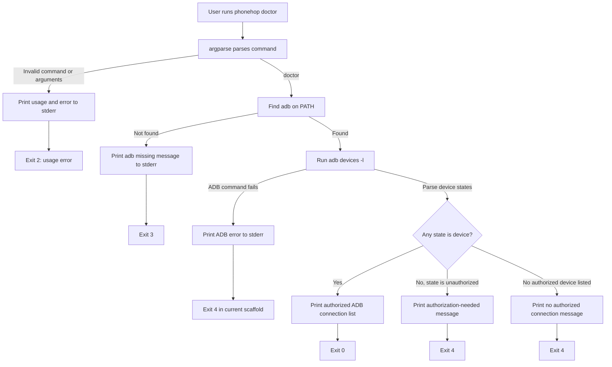
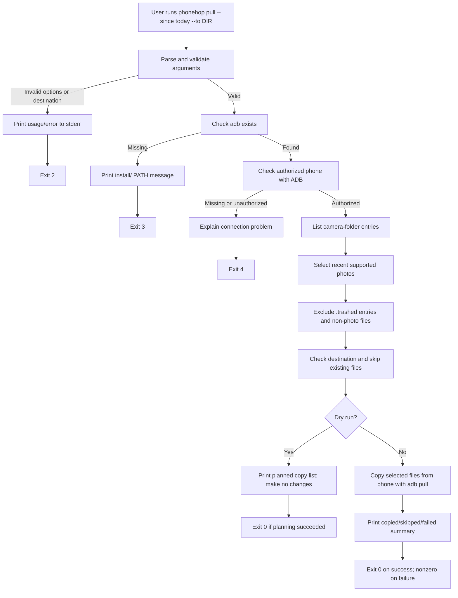

# phonehop

> A planned command-line helper for checking an Android ADB connection and safely copying recent camera photos to a Mac or Linux computer.

**Team:** TODO — add both team members  
**Repository:** TODO — add the GitHub repository URL  
**Date:** 29-10-2026

## Project status

This repository contains an early Python scaffold for `phonehop doctor`. The scaffold has not yet been installed or run. The ADB connection itself has been tested manually on the author's Mac; the `phonehop` commands and any speed or reliability benefit have not been verified.

Labels in this README mean:

- **Observed:** collected from the student's own computer or phone.
- **Researched:** supported by a linked source; it is not necessarily a hands-on trial.
- **Planned:** part of the proposed design, not implemented yet.
- **TODO — must collect:** evidence or a decision that still needs to come from the team.

## 1. The problem

### What the student does today

**Observed:** The student uses LocalSend every day to move files from an Android phone to a Mac.

**Observed / supplied by the student:** The phone is a OnePlus 13R running OxygenOS 16.0.10. The student believes it is Android 16, but the Android version has not been verified. The ADB output reported model `CPH2691`.

**TODO — must collect:** Write down the exact tap-by-tap LocalSend sequence, how many times it is used, how many files are usually sent, and the time and taps for a typical transfer. The current sequence is a phone-and-desktop app workflow, not a sequence of terminal commands, so do not invent shell commands for it.

**Current sequence answer:** No exact tap-by-tap sequence has been recorded yet. It must be written from the student's actual LocalSend use; this README does not guess which buttons or prompts appear.

### Evidence from the student's machine

The following is real machine output supplied by the student:

```text
$ which adb
/opt/homebrew/bin/adb

$ adb version
Android Debug Bridge version 1.0.41
Version 37.0.1-15733141
Installed as /opt/homebrew/bin/adb
Running on Darwin 25.5.0 (arm64)

$ python3 --version
Python 3.15.2
```

Wireless pairing and connecting were also performed manually. The phone then appeared in `adb devices -l` with state `device`, which means ADB considered that connection authorized. The captured output listed two ADB transports with the same phone model; these may be two connection paths to one phone, so they should not be counted as two physical phones without checking. Local IP addresses and identifiers are redacted here.

```text
$ adb devices -l
List of devices attached
<redacted-ip:port>  device product:CPH2691IN model:CPH2691 device:OP5D3BL1 transport_id:3
<redacted-wireless-service-id> device product:CPH2691IN model:CPH2691 device:OP5D3BL1 transport_id:2
```

**Observed:** A read-only listing of `/sdcard/DCIM/Camera` included photos, videos, and entries whose names begin with `.trashed-`. This means a photo-copy design must handle non-photo files and trashed entries deliberately. It does not prove that a date filter or copy command works.

**TODO — must collect:** The exact current LocalSend steps and their cost. Do not claim that phonehop is faster or more reliable until it is compared with the current workflow.

**Frequency and cost:** I use LocalSend every day. I have not measured the time or number of taps for each transfer yet, so I cannot honestly state its cost per use.

### Who else has mentioned this

One other Android-and-Mac user said they also use LocalSend, that some third-party apps feel slow, and that their Mac sometimes does not appear on the same network. This is one person's anecdotal report, not evidence about all users. We have not yet run a structured interview or reproduced the network issue.

## 2. Prior art — what already exists

Prior art is the hardest part of this assignment. These tools show that file sharing, ADB transfers, and Android screen mirroring already exist. The research below describes what their official sources say; it does **not** replace the required install-and-run trials.

### Tools researched and trial status

| Tool | Researched purpose | What we have actually tried | What remains to learn for this workflow |
|---|---|---|---|
| [LocalSend](https://github.com/localsend/localsend) | Shares files and messages with nearby devices over a local network. | The student uses it every day, but a measured baseline and documented trial output are still TODO. | Record the exact steps, time, taps, success/failure, and compare a fixed set of files. |
| [Android Debug Bridge (ADB)](https://developer.android.com/tools/adb) | Provides device commands, including pulling files from a device and pushing files to it. | Pairing, wireless connection, `adb devices -l`, and camera-folder listing were run. A file transfer with `adb pull` or `adb push` has not been run. | Try a safe, small, explicitly selected photo pull. `adb push` writes to the phone and conflicts with the current read-only-phone rule, so it is excluded from v1 unless that rule changes. |
| [scrcpy](https://github.com/Genymobile/scrcpy) | Mirrors and controls an Android screen over USB or TCP/IP. | Not installed or trialed on this Mac, according to the student's last reported status. | Test only if needed to document the adjacent screen-mirroring use case. It is not a photo-transfer tool, and its control features need their own safety consideration. |
| [KDE Connect](https://apps.kde.org/kdeconnect/) | Connects phones and computers for file access/sharing, clipboard, notifications, and other integration. | Not trialed. | Check whether its Mac-and-Android workflow addresses the same task; record hands-on evidence before comparing. |

### Evidence collected so far and the current limit

The commands `adb pair`, `adb connect`, `adb devices -l`, and a read-only camera-folder listing were run manually; the real outputs are summarized in the Problem and Usage sections. These commands show that wireless ADB pairing and device discovery worked on this Mac. They do **not** show that ADB photo transfer works, that it is easier than LocalSend, or that any prior-art tool falls short. A file-transfer trial and side-by-side comparison are still TODO.

### Research-based command examples

These examples explain the ADB building blocks. Angle-bracket values are placeholders. Only the ADB discovery, pairing, connection, and folder-listing steps above have been performed on the student's device. The file-transfer examples have **not** been run.

```bash
# See devices and their states (run on the student's Mac)
adb devices -l

# Pair once using the temporary address/port and code shown by Android Wireless debugging
adb pair <phone-ip>:<pairing-port>

# Connect using the separate address/port on the main Wireless debugging screen
adb connect <phone-ip>:<connect-port>

# Research example: copy one chosen remote file to a local destination
adb pull <phone-file-path> <local-destination>
```

Android's ADB reference documents the `adb pull <remote> <local>` direction and the opposite `adb push <local> <remote>` direction. `push` writes a file onto the phone, so it does not satisfy phonehop's current promise to leave phone files unchanged. [Android Debug Bridge reference](https://developer.android.com/tools/adb)

### Where we searched

- [x] Official project pages/repositories: LocalSend, scrcpy, KDE Connect, and Android ADB documentation.
- [x] Homebrew formula pages for Android Platform-Tools and scrcpy.
- [x] Asked one Android-and-Mac user; their report is anecdotal and summarized above.
- [ ] `man -k` on the student's Mac or a Linux machine.
- [ ] GitHub search for close alternatives, beyond reviewing the official repositories above.
- [ ] Run `brew search` locally and record its real output.
- [ ] Stack Overflow search.
- [ ] npm and PyPI search for related command-line tools.
- [ ] Install and run at least three prior-art tools and record commands, real output, what worked, and what was missing.

### The gap, honestly

**Not established yet.** Existing tools can already share files, transfer files with ADB, and mirror/control an Android screen. We have not completed the required trials, so we cannot yet say that none of them handles the student's workflow or that phonehop fills a proven gap. If the trials do not reveal a meaningful gap, revise the scope instead of claiming one.

**Template sentence:** “Existing tools can already share files and transfer them with ADB, but we have not yet established which part of the student's LocalSend workflow, if any, remains costly after trying those tools.” This is a research question, not a claim that a gap exists. The assignment says to discuss the idea with the instructor if the team cannot complete the gap sentence honestly; do that before presenting a gap as a conclusion.

## 3. What we are building

### In scope for the read-only first version

- `phonehop doctor`: check whether ADB is installed and report the state of ADB connections.
- `phonehop connect IP:PORT`: ask ADB to connect to an already-paired phone's current wireless-debugging endpoint.
- `phonehop pull --since today --to DIR [--dry-run]`: planned selection and copying of recent camera photos, skipping files that already exist on the computer.
- A dry-run for the pull path, so the tool can display the proposed copy list without copying.
- macOS and Linux support as a goal; acceptance of macOS for this Linux assignment still needs instructor confirmation.

“Read-only” here means phonehop will not change or delete phone files. The user has to enable Developer options/Wireless debugging and pair the computer; those setup steps change phone settings or its trusted-device authorization. They are manual setup actions, not hidden phonehop file operations.

### Out of scope or unresolved

- Automatic pairing in version 1; the user pairs with `adb pair` manually.
- Clipboard synchronization or building a phone app.
- Rebuilding screen mirroring; scrcpy already exists. A scrcpy launcher is a stretch idea and is not required for the read-only first version.
- Deleting or modifying phone files.
- **`phonehop push` is excluded from v1 while the read-only-phone rule remains.** ADB `push` copies local files onto the device, so it directly conflicts with that rule. Reconsider it only if the team explicitly changes the safety boundary.
- Overwriting files on the computer; the planned pull command must skip existing destination files.
- An optional `mirror` launcher is not part of the read-only first version. scrcpy is an existing mirroring/control tool; keep it out of the demo unless its behavior and the safety boundary are reviewed separately.

### How we will know it worked

First, collect the current LocalSend baseline. Then compare the same set of 10 photos using LocalSend and the completed phonehop pull command over three timed runs. Record elapsed time, taps/commands, success count, and any duplicate or overwrite behavior. A useful result is a repeatable reduction in the chosen time or interaction measure, with all intended files transferred and zero overwrites. Until that comparison is complete, do not call phonehop faster or more reliable. The team should also decide whether it still wants to use the tool after the assignment.

## 4. Tech stack

| Choice | Current selection | Why / alternative considered | Status |
|---|---|---|---|
| Language | Python 3 | Both teammates know Python; it is available on macOS and Linux. | Scaffold written, not run. |
| Argument parsing | `argparse` | Included in Python and suitable for commands and flags. | Used for `doctor` in `src/phonehop/cli.py`. |
| ADB integration | Python `subprocess` | Calls the installed ADB program; passing an argument list avoids building a shell command string. | Used for `adb devices -l` in the `doctor` scaffold. |
| Other runtime dependencies | None planned | Keeps runtime setup small; Android Platform-Tools/ADB is a separate prerequisite. | Not verified by installation. |
| Testing | Python `unittest` or another standard-library approach | Keep tests compatible with the no-extra-runtime-dependency goal. | TODO — no tests are present yet. |
| Packaging | `pyproject.toml`, virtual environment, editable install | Provides a `phonehop` console command during development. | Configuration exists; install is not tested. |

### Why Python, and what changes on Linux

Python is the practical choice because both teammates know it. `argparse`, `subprocess`, and `shutil.which` are standard-library tools for building a small CLI, locating ADB, and launching it. The same Python code is intended to run on macOS and Linux. The operating-system-specific part is primarily installing ADB and confirming that it is on `PATH`; the exact Linux instructions depend on the distribution and are TODO. The instructor must confirm whether a macOS implementation is accepted for an assignment that says Linux.

Bash was considered, but careful argument handling and portable behavior across macOS and Linux would need extra attention. Go was considered, but it would add a build and distribution step for this small first version. These are project tradeoffs, not claims that one language is always better.

### What the code currently contains

The current source tree is:

```text
pyproject.toml
src/phonehop/__init__.py
src/phonehop/cli.py
```

`cli.py` currently defines a `doctor` command. It locates `adb` with `shutil.which`, runs `adb devices -l` with `subprocess.run`, parses the connection states, writes a short status message, and returns an exit code. The current scaffold does not implement `connect`, `pull`, `push`, or `mirror`. It has not been installed or executed, so this description is of the source code, not verified behavior.

The original larger design split responsibilities across `cli.py`, `adb.py`, `commands.py`, and possibly `platform_utils.py`. Those modules do not exist yet. Keep the implementation simple; add a platform helper only if actual macOS/Linux differences require one.

## 5. Architecture

### Current command flow: `phonehop doctor`

This diagram describes what the current source intends to do. It has not been run. Python `argparse` normally prints usage for invalid arguments and exits with status 2; the rest of the proposed exit behavior is listed in the Usage section and still needs verification.



The two ADB entries seen in the real output may be two transports for the same phone. The scaffold currently reports the number of authorized ADB connections, not a deduplicated count of physical phones.

### Planned command flow: `phonehop pull`

The pull flow below is planned, not implemented. The exact camera-file listing and date rule must be chosen and tested. The folder listing contained `.trashed-*` entries and videos, so the filter must deliberately include supported photo types and exclude trashed items and videos unless the scope changes.



### Components and data flow

| Component | Responsibility | Current/planned file |
|---|---|---|
| CLI and argument parsing | Turn `phonehop <command>` into a command and validated options. | `src/phonehop/cli.py` (current) |
| ADB wrapper | Run ADB commands and capture output/return status. | Planned `src/phonehop/adb.py`; currently handled directly in `cli.py` for `doctor`. |
| Command logic | Check devices, connect, select camera photos, and perform a pull. | `doctor` currently in `cli.py`; other commands are planned. |
| Platform helpers | Handle a proven OS-specific difference, if one is needed. | Planned only; no `platform_utils.py` exists. |
| Packaging | Expose the Python entry point `phonehop`. | `pyproject.toml` (current configuration, not install-tested). |

For `doctor`, the input is CLI arguments and the output of `adb devices -l`; the tool parses connection states and prints a status message. For a future pull, ADB will provide camera-folder metadata and file bytes; phonehop will filter entries, check the local destination, then use ADB to copy selected phone files to the computer. The pull command must not write to or delete phone files.

### What happens when things go wrong

| Failure | Planned/current response |
|---|---|
| ADB is not on `PATH` | Print a concise install/PATH message to stderr and return code 3. This path is in the scaffold but not run. |
| Phone is absent or unauthorized | Explain that the phone is missing or needs authorization; return code 4. This path is in the scaffold but not run. |
| Invalid command or flag | Let `argparse` print usage and return code 2. Verify with a real invocation. |
| ADB command returns an error | Print its diagnostic to stderr. Current `doctor` code maps a failed `adb devices -l` command to code 4; confirm whether that should instead be general failure code 1. |
| Destination contains a same-named file | Future pull must skip it and report the skip; never overwrite. Not implemented. |
| Wireless network drops during a pull | Stop/report the failed transfer, preserve local files already copied, and never delete or modify phone files. Exact recovery behavior is TODO. |

## 6. Usage

### Current status

The console entry point is configured in `pyproject.toml`, but it has not been installed or run. The only command represented in the current source is `phonehop doctor`. All other commands below are planned interface examples, not working commands.

### Planned synopsis

```text
phonehop <command> [options]
```

### Planned commands

| Command | Purpose | Implementation status |
|---|---|---|
| `phonehop doctor` | Check that ADB is installed and report device connection states. | Source scaffold exists; not installed or run. |
| `phonehop connect IP:PORT` | Connect to the current Wireless debugging endpoint after manual pairing. | Planned; not implemented. |
| `phonehop pull --since today --to DIR [--dry-run]` | Plan or copy recent camera photos to a local directory, skipping existing files. | Planned; not implemented. |
| `phonehop push FILE...` | Earlier proposal for copying files to the phone. | Excluded from v1 while the no-phone-modification rule remains; `adb push` writes to the phone. |
| `phonehop mirror` | Possible launcher for scrcpy. | Stretch idea only; not implemented and not part of read-only v1. |

### Real ADB outputs collected so far

These are actual outputs from manual ADB use. Local network addresses and identifiers have been redacted.

```text
$ adb pair <redacted-ip>:<redacted-pairing-port>
Successfully paired to <redacted> [guid=<redacted>]

$ adb connect <redacted-ip>:<redacted-connect-port>
connected to <redacted>

$ adb devices -l
List of devices attached
<redacted-ip:port> device product:CPH2691IN model:CPH2691 device:OP5D3BL1 transport_id:3
<redacted-wireless-service-id> device product:CPH2691IN model:CPH2691 device:OP5D3BL1 transport_id:2
```

The `phonehop` equivalent output is **TODO — must collect after installation and running the program**. Do not present invented `phonehop` output as a real result.

### Proposed exit codes

| Code | Proposed meaning | Status |
|---:|---|---|
| 0 | Success | Proposed; not verified. |
| 1 | General failure | Proposed; behavior needs implementation and verification. |
| 2 | Usage error | Expected from `argparse`; verify through a real invocation. |
| 3 | ADB missing | Implemented in source scaffold; not run. |
| 4 | No phone or unauthorized | Implemented in source scaffold; not run. |

### Installation

The following steps are the planned installation instructions and have not yet been tested from a clean checkout. ADB must be installed separately from phonehop.

On macOS, the official Homebrew Cask currently lists this ADB installation command:

```bash
brew install --cask android-platform-tools
```

Source: [Homebrew Android Platform-Tools Cask](https://formulae.brew.sh/cask/android-platform-tools). The student's Mac already has ADB installed. For Linux, install Android Platform-Tools using the relevant distribution package or Google's official SDK Platform-Tools download; exact distribution-specific commands are TODO. Confirm Linux and macOS acceptance with the instructor.

After installing ADB and Python 3.10 or newer, clone the repository and install the Python project:

```bash
git clone <repository-url>
cd phonehop
python3 -m venv .venv
source .venv/bin/activate
python -m pip install -e .
phonehop doctor
```

The phone must have Developer options and Wireless debugging enabled, and the workstation must be paired/authorized. The installation commands above are documentation, not verified results; test them on the other teammate's computer before submission.

## 7. References

- [Android Debug Bridge (ADB) | Android Developers](https://developer.android.com/tools/adb) — official command reference; documents device selection and the direction of `adb pull` and `adb push`.
- [SDK Platform-Tools releases | Android Developers](https://developer.android.com/tools/releases/platform-tools) — official Android Platform-Tools download page.
- [Connect to your device using Wi-Fi | Android Developers](https://developer.android.com/studio/run/device.html) — official wireless-debugging setup and pairing guidance. Menu details may differ by Android/OxygenOS version; verify on the OnePlus.
- [LocalSend official repository](https://github.com/localsend/localsend) — describes local-network file and message sharing; used to identify LocalSend as prior art, not as evidence of its limitations.
- [scrcpy official repository](https://github.com/Genymobile/scrcpy) — describes Android screen mirroring and control; used to identify an adjacent tool, not a phonehop transfer trial.
- [KDE Connect](https://apps.kde.org/kdeconnect/) — describes phone/computer integration and file access/sharing; identified as another prior-art candidate, not trial evidence.
- [Homebrew Android Platform-Tools Cask](https://formulae.brew.sh/cask/android-platform-tools) — current Homebrew install command for ADB on macOS.
- [Homebrew scrcpy formula](https://formulae.brew.sh/formula/scrcpy) — current Homebrew package information for the optional screen-mirroring candidate.

## Completion checklist

- [ ] Add team names and GitHub URL.
- [ ] Record the exact LocalSend workflow, frequency, time, and taps from the student's own use.
- [ ] Verify the phone's Android version and confirm macOS acceptance with the instructor.
- [ ] Install and run at least three prior-art tools; save commands and real outputs.
- [ ] Search the remaining locations listed in the prior-art section.
- [ ] Decide whether the evidence supports a real gap; revise the idea if it does not.
- [ ] Resolve the `push` versus read-only-phone safety conflict by keeping `push` out of v1 or explicitly changing the requirement.
- [ ] Finish and run `phonehop doctor`; capture real success and failure outputs and verify exit codes.
- [ ] Implement and safely verify `connect` and a dry-run photo pull; exclude `.trashed-*`, non-photo files, and existing local files.
- [ ] Measure LocalSend and phonehop on the same 10 photos over three runs; report the result honestly.
- [ ] Test installation on another laptop and verify the Linux path.
